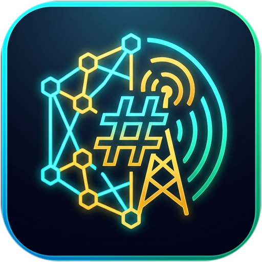
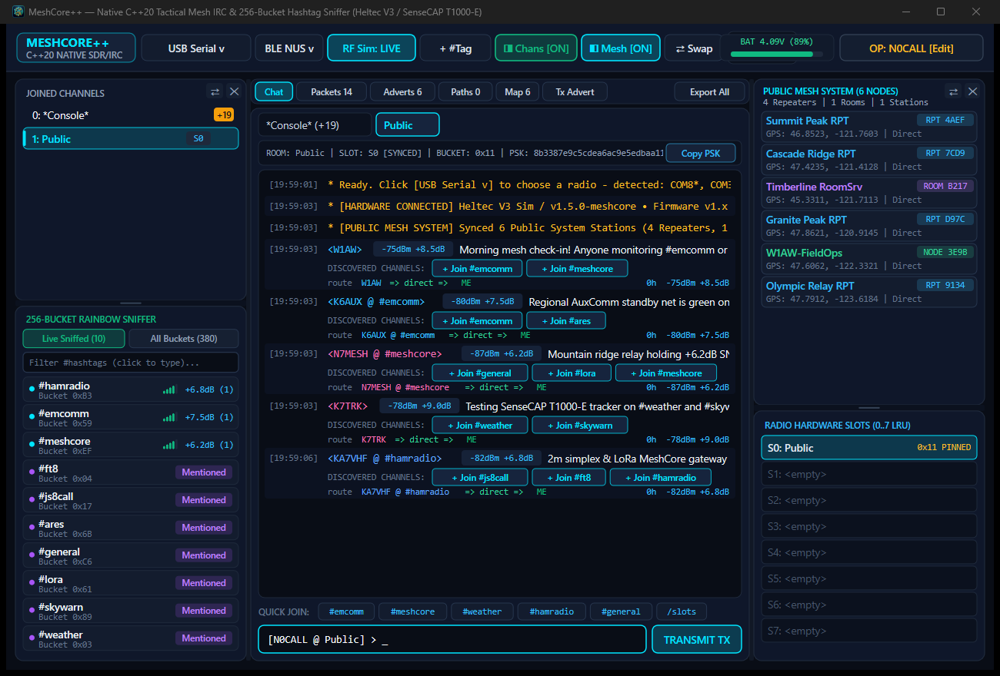
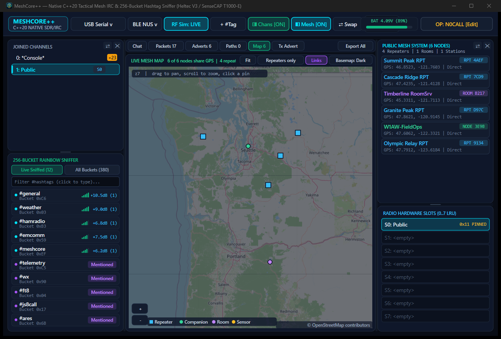
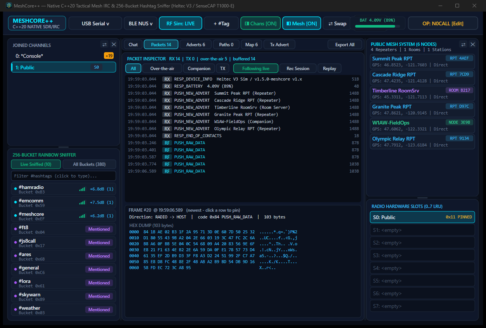

<div align="center">



# MeshCore++

**Native C++20 Tactical LoRa Mesh IRC Client, 256-Bucket Hashtag Channel Sniffer, Packet Inspector & Live Map**

[-00E5FF?style=for-the-badge)](#downloads--installation)
[](#building-from-source)
[](#supported-hardware--transports)

</div>

---

**MeshCore++** is a zero-bloat, hardware-accelerated native desktop client for **MeshCore Companion Radios** (including the **Seeed Studio SenseCAP T1000-E**, **Heltec WiFi LoRa 32 V3**, **RAK WisBlock**, and **LilyGO** LoRa nodes). Built in pure **C++20** with Direct2D/DirectWrite on Windows and Cocoa/CoreGraphics/CoreText/CoreBluetooth on macOS Sonoma+, it pairs an IRC-style multi-channel workstation with a real-time **256-Bucket SHA-256/AES-128 Hashtag Channel Sniffer**, **Over-the-Air Packet Inspector**, **Repeater Path Tracer**, and **Live Tactical Mesh Map**.

---

## Screenshots

### 1. IRC Workstation & 256-Bucket Rainbow Hashtag Sniffer


### 2. Live Tactical Mesh Map (OpenStreetMap + Repeater Topology)


### 3. Over-the-Air Packet Inspector & Hex Analyzer


---

## Key Features

- **256-Bucket SHA-256 / AES-128 Hashtag Channel Sniffer**
  - Passively intercepts raw over-the-air MeshCore group frames (`PUSH_RAW_DATA` `0x84` & `PUSH_LOG_RX_DATA` `0x88`) across all 256 1-byte channel hash buckets (`SHA256(PSK)[0]`).
  - Pre-computes a rainbow dictionary of 380+ common hashtag channels (`#emcomm`, `#meshcore`, `#weather`, `#hamradio`, `#general`, `#sar`, US states, major metro areas, `#ch0`–`#ch99`, plus custom `wordlist.txt` entries).
  - Automatically extracts new `#hashtag` channels mentioned inside decrypted chat messages and dynamically adds their derived keys (`SHA256("#tag")[0..16]`) to the live sniffer in real time.
  - **Promiscuous Decryption**: Even when you are only joined to `Public`, sniffed traffic on unjoined `#hashtag` channels is previewed inline with one-click **`+ Join #channel`** pills.

- **Hardware Slot Synchronization (8-Slot LRU Table)**
  - Slot `0` is permanently pinned to the MeshCore `Public` channel (`8b3387e9c5cdea6ac9e5edbaa115cd72`).
  - Joining any `#hashtag` room automatically programs the derived 16-byte PSK into hardware slots `1..7` via `CMD_SET_CHANNEL` (`0x20`) with LRU eviction.

- **Triple-Transport Architecture**
  - **USB Serial (`115200 8N1`)**: Auto-detects CP210x, CH340/CH9102, FTDI, and USB CDC-ACM ports (`COMx` on Windows, `/dev/cu.usb*` via `IOKit` on macOS) with `0x3C` (host $\to$ radio) and `0x3E` (radio $\to$ host) binary framing.
  - **Bluetooth Low Energy (`BLE NUS`)**: Native **CoreBluetooth** (macOS Sonoma+) and **WinRT BLE GATT** (Windows 10/11) client for the Nordic UART Service (`6E400001-B5A3-F393-E0A9-E50E24DCCA9E`), supporting unframed GATT writes/notifications and BLE pairing with the **SenseCAP T1000-E** and **Heltec V3**.
  - **Built-in Live RF Simulator**: Synthesizes real AES-128 encrypted LoRa group frames, repeater beacons, battery telemetry, and CLI responses so you can test the entire UI without hardware attached.

- **Snooping & Diagnostics Toolkit**
  - **Packet Inspector**: Live capture of all Companion and Over-the-Air RF frames with filtering (`All`, `Over-the-air`, `Companion`, `TX`), full hex/ASCII dump, session recording/replay, and CSV export.
  - **Adverts & Node Directory**: Tracks Repeaters, Room Servers, Sensors, and Companion Stations with RSSI, SNR, hop count, and GPS coordinates. Double-click any node to open a direct message or remote Repeater CLI session.
  - **Path Tracer**: Visualizes multi-hop repeater routes (`4A => 7C => ME`), tracks relay statistics, and supports active route tracing (`/tracepath`).
  - **Live Mesh Map**: Interactive dark/light OpenStreetMap slippy map with automatic disk tile caching, repeater link overlays, and KML/CSV export.

---

## Supported Hardware & Transports

| Device | MCU / Radio | USB Serial | BLE NUS (`6E400001-...`) |
| :--- | :--- | :---: | :---: |
| **Seeed Studio SenseCAP T1000-E** | nRF52840 + LR1110 | USB CDC-ACM | Native CoreBluetooth / WinRT GATT |
| **Heltec WiFi LoRa 32 V3** | ESP32-S3 + SX1262 | CP2102 USB-UART | Native CoreBluetooth / WinRT GATT |
| **RAK WisBlock 4631** | nRF52840 + SX1262 | USB CDC-ACM | Native CoreBluetooth / WinRT GATT |
| **LilyGO T-Deck / T-Echo / T3-S3** | ESP32-S3 / nRF52840 | USB CDC-ACM / CH9102 | Native CoreBluetooth / WinRT GATT |

---

## Downloads & Installation

Pre-built binaries are available on the [**GitHub Releases**](https://github.com/andarazoroflove/MeshCorePlusPlus/releases) page and in the [`releases/`](releases/) folder:

### Windows 10 / 11 (`x86_64`)
- **Standalone Executable**: [`MeshCorePlusPlus-Windows-GUI.exe`](https://github.com/andarazoroflove/MeshCorePlusPlus/releases/download/v1.0.0/MeshCorePlusPlus-Windows-GUI.exe)
- Zero external runtime dependencies — statically linked C++20 / Direct2D / DirectWrite / WinHTTP binary. Simply download and run.

### macOS Sonoma 14.0+ (`Universal Binary`: Apple Silicon `arm64` + Intel `x86_64`)
- **macOS Application Bundle (`.zip`)**: [`MeshCorePlusPlus-macOS-Sonoma.zip`](https://github.com/andarazoroflove/MeshCorePlusPlus/releases/download/v1.0.0/MeshCorePlusPlus-macOS-Sonoma.zip)
- **Standalone Universal Binary**: [`MeshCorePlusPlus-macOS-Sonoma-Universal`](https://github.com/andarazoroflove/MeshCorePlusPlus/releases/download/v1.0.0/MeshCorePlusPlus-macOS-Sonoma-Universal)
- **Connecting a SenseCAP T1000-E over Bluetooth on macOS**:
  1. Unzip `MeshCore++-macOS-Sonoma.zip` and launch `MeshCore++.app` (if Gatekeeper prompts on first launch, run `xattr -cr MeshCore++.app` or Right-Click $\to$ **Open**).
  2. Click **`BLE NUS v`** in the top toolbar and grant macOS Bluetooth permission when prompted.
  3. Select your **SenseCAP T1000-E** (or click **Scan / Auto-Connect BLE NUS**). If pairing for the first time, enter your radio's BLE pairing PIN (default MeshCore PIN: `123456`).

---

## IRC & Tactical Slash Commands

Type any command into the bottom composer bar:

| Command | Description |
| :--- | :--- |
| `/join #channel` | Derive the SHA-256 PSK for `#channel`, sync it to a radio hardware slot (`1..7`), and open its room tab |
| `/part [#channel]` | Close the current or specified `#hashtag` channel tab |
| `/nick <CALLSIGN>` | Set your operator callsign (also editable via the top-right `OP: ... [Edit]` button) |
| `/dm <node> <text>` | Send an encrypted direct message to a discovered station |
| `/login <node> <pw>` | Authenticate as admin with a remote MeshCore Repeater or Room Server |
| `/cli <node> <cmd>` | Send a remote CLI command (`ver`, `clock`, `neighbors`, `stats`, `advert`) to a Repeater |
| `/status <node>` | Request live battery, noise floor, and uptime telemetry from a remote node |
| `/tracepath <hops>` | Send an active multi-hop RF trace packet across specified repeater prefixes or node names |
| `/advert [name]` | Broadcast a self-advertisement beacon over LoRa RF |
| `/slots` | Display the current 8-slot hardware channel table (`S0..S7`) |
| `/psk [#channel]` | Show the 16-byte hex PSK and 1-byte SHA-256 bucket hash for a channel |
| `/export` | Export discovered nodes, packets, adverts, and KML map pins to `./exports/` |

---

## Building from Source

MeshCore++ is header-organized in [`cpp/`](cpp/) with zero third-party library dependencies:

- [`cpp/main_gui.cpp`](cpp/main_gui.cpp) — Direct2D/DirectWrite GUI workstation, 3-pane dockable layout, Packet Inspector, Path Tracer, and Slippy Map engine
- [`cpp/crypto.hpp`](cpp/crypto.hpp) — Standalone C++20 SHA-256, HMAC-SHA256, AES-128-ECB/CBC, and 256-Bucket Rainbow Table Sniffer
- [`cpp/protocol.hpp`](cpp/protocol.hpp) — MeshCore Companion framing (`0x3C`/`0x3E`), over-the-air packet dissector, and 8-slot LRU manager
- [`cpp/transport.hpp`](cpp/transport.hpp) — Multi-threaded USB Serial, CoreBluetooth / WinRT BLE NUS GATT client, and Live RF Simulator
- [`cpp/macos_d2d_shim.hpp`](cpp/macos_d2d_shim.hpp) — Native Cocoa / CoreGraphics / CoreText / ImageIO translation layer for macOS Sonoma+

### Compile on Windows (LLVM-MinGW / MinGW-w64)
```powershell
clang++ -O2 -std=c++20 -mwindows -Icpp cpp/main_gui.cpp cpp/resource.o -o releases/MeshCore++-Windows-GUI.exe `
  -ld2d1 -ldwrite -lwindowscodecs -lole32 -luuid -lwinhttp -lws2_32 -liphlpapi -ldwmapi -luxtheme `
  -lgdi32 -luser32 -lshell32 -lcomdlg32 -lsetupapi -static
```

### Compile on macOS Sonoma+ (Xcode Command Line Tools)
```bash
clang++ -O2 -std=c++20 -Icpp cpp/main_gui.cpp -o MeshCore++ \
  -framework AppKit -framework Foundation -framework CoreGraphics \
  -framework CoreText -framework CoreFoundation -framework ImageIO \
  -framework IOKit -framework CoreBluetooth -lobjc
```

### Run Cryptographic & Protocol Unit Tests
```bash
clang++ -O2 -std=c++20 -Icpp cpp/test_crypto.cpp -o test_crypto && ./test_crypto
```

---

## License

Released under the MIT License. Map tiles © [OpenStreetMap](https://www.openstreetmap.org/copyright) contributors.
